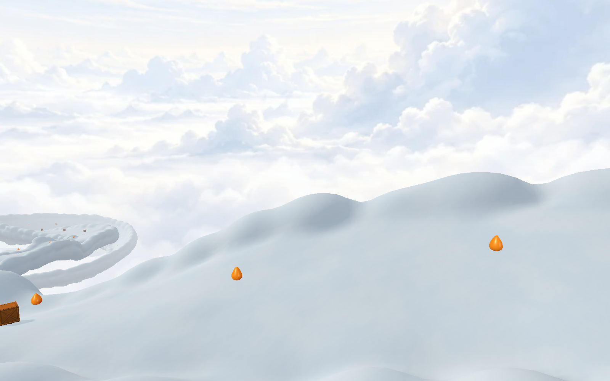
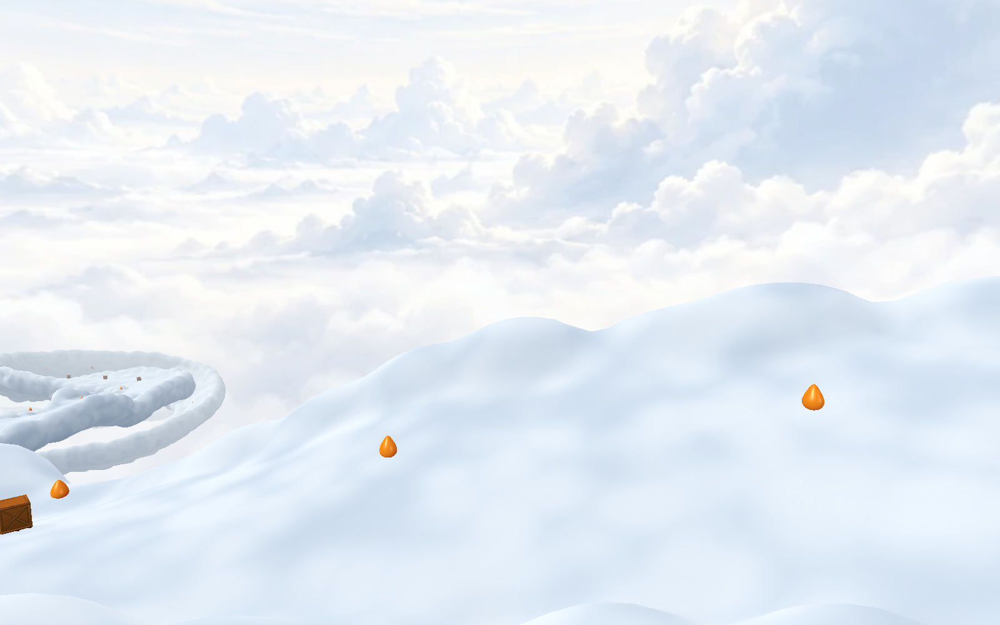
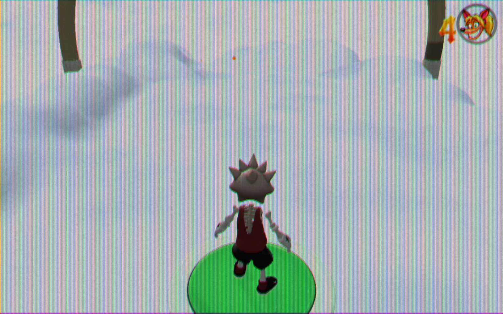

# Skystream cloud lighting and selective fringes — 29 October 2026 NZDT

The main course now combines its complete opaque cloud shell with baked light
penetration, one shared filtered 3D noise field, and sparse volumetric wisps along
exposed shoulders and undersides. The independent smooth contact ribbon, route,
loops, movement tuning, original skybox, blue gradient and sun effects are retained.

## Rendering and bounds

- **Surface lighting:** integrate the actual cross-section contour toward the
  authored sun during construction. Store direct transmission and a broader
  scattering approximation in two normalized bytes per vertex. Shared chunk
  boundaries receive identical values. Project the sun into each road frame,
  including rotated meshes and the horizontal wall loop.
- **Cloud detail:** a deterministic, periodic 64³ RGBA8 field packs broad
  value/Worley billows and two detail bands. One trilinear, mip-filtered lookup
  replaces the previous six procedural-noise octaves per surface fragment.
  World coordinates anchor the detail through motion and loop rotations.
- **Volumetric fringes:** 850 small ellipsoidal domains in 25 instanced batches.
  Two shoulder wisps occur approximately every 13 m, with an underside wisp at
  every other station. Each has a 0.5 m outward radius and a 0.1 m outward offset
  at its attachment; longitudinal radii stay between 1.5 and 2 m. Each visible
  fragment integrates eight fixed samples using the same texture as the shell.
  Smooth density and low opacity create a subtle transition around the silhouette.
  Back-face depth testing conservatively rejects domains covered by the opaque
  road. The wisps never write depth or enter collision queries.

All 206 opaque chunks and 1,626,016 authored triangles remain. Additional proxy
boxes have 10,200 instanced triangles total; they are sampling bounds, not visible
replacement geometry. Culling retains complete geometry and wisps at every
viewing distance, including reflections. No time-varying jitter, temporal history,
per-frame cloud allocation, distance LOD, or extra density volumes are introduced.

The shared texture occupies 1,198,372 bytes including mipmaps. Baked shell
attributes add 1,687,090 bytes. Wisp matrices/light values use 56,100 bytes;
25 small box geometries add approximately 21,000 bytes. Together the added GPU
buffers/texture are approximately **2.83 MiB**, excluding driver overhead. Every
surface/fringe material owns a lease; the final disposal releases the shared
texture. Reloads recreate exactly the same seeded field.

This is an intentionally bounded approximation: the opaque shell's light depth
comes from an extruded cross-section, limited to 12 m, and end caps reuse the
adjacent ring's light values. It is not a full 3D light-transport solution. The
bake follows Skystream's fixed authored sun; changing its direction requires
rebuilding the road. Only the small fringe domains march rays during play.

## Validation and reproduction

Run the following focused checks; no level data changes are involved:

```sh
node tools/test-cloud-road-lighting.mjs
node tools/test-skystream-clouds.mjs
node tools/test-skystream.mjs
npm run build
npm run check:release
```

The optical-depth test covers sunward/shaded separation, broad scattering,
rotation invariance, ring/chunk seams, shared surface/fringe noise, bounded wisp
matrices, deterministic reloads, mip filtering and idempotent disposal. The full
native level test also verifies that leaving the actual course releases all
material leases. Geometry comparison with the published `24c16a77` implementation
finds identical position, normal and index bytes for curved road, upright loop
and horizontal wall-loop fixtures: [geometry comparison](geometry.json).

For the controlled Chrome comparison, run a Vite development server and:

```sh
node tools/skystream-cloud-lighting-browser.mjs http://127.0.0.1:5187/
node tools/skystream-cloud-lighting-browser.mjs http://127.0.0.1:5187/ --detail-only
```

Set `PLAYWRIGHT_MODULE` if Playwright is provided by the local Codex runtime.
`CLOUD_LIGHTING_OUTPUT` controls the output directory. The comparison retains
the exact previously published material in a review-only fixture. It alternates
old material, new lighting only, and lighting plus fringes in ABCCBA order with
20 samples per variant at 1152×720 and native 1600×1000. GPU timer queries must
report no disjoint event. These measurements cover an isolated cloud render
pass, not whole-game FPS. Actual game presentation is checked separately with
normal CRT settings and MAX/native rendering. A fixed-camera repeat checks for
identical pixels on successive frames.

## Measured result

On this Mac in Chrome, the final cloud-only pass stayed close to the old
material's cost. MAX wall-loop rendering is approximately 0.37 ms slower in this
run; most other measured medians improve. Across the comparisons, the small
fringe pass typically adds hundredths to a few tenths of a millisecond over
lighting alone. Small negative differences are measurement noise, not free work.
These are device/scene-specific observations, not a whole-game frame-rate claim.

| View | Resolution | Old (ms) | Lighting only (ms) | With fringes (ms) | Change from old (ms) |
| --- | --- | ---: | ---: | ---: | ---: |
| road | 1152×720 | 3.101 | 2.877 | 2.915 | -0.186 |
| road | 1600×1000 | 4.173 | 3.977 | 4.074 | -0.099 |
| upright-loop | 1152×720 | 9.757 | 9.676 | 9.317 | -0.440 |
| upright-loop | 1600×1000 | 13.858 | 12.565 | 12.825 | -1.032 |
| wall-loop | 1152×720 | 13.856 | 13.725 | 13.745 | -0.111 |
| wall-loop | 1600×1000 | 14.782 | 15.108 | 15.156 | +0.375 |

[GPU comparison and actual texture accounting](gpu-browser.json),
[close-up comparison](closeup-browser.json), and [native route](native-route.json).
The fixed grazing camera produced identical pixels across frames; turning the
wisps off changed 791 of 64,000 pixels, confirming a small visible contribution.
Both shader variants and the fringes share one actual texture across 50 material
owners. Unit construction of that field takes roughly 140–150 ms once; it is
not rebuilt during play. Three geometry fixtures retain byte-identical shells.





## Research provenance

The transferable ideas are packed periodic 3D cloud noise, extinction and broad
scattering from [Guerrilla's cloud-rendering presentation](https://d3d3g8mu99pzk9.cloudfront.net/AndrewSchneider/The-Real-time-Volumetric-Cloudscapes-of-Horizon-Zero-Dawn.pdf),
and the texture/fragment-cost tradeoffs described by
[GPU Gems, chapter 39](https://developer.nvidia.com/gpugems/gpugems/part-vi-beyond-triangles/chapter-39-volume-rendering-techniques).
The contour bake, packed field, material and bounded fringe renderer are original
code using the existing Three.js dependency. No third-party source or asset was
added. The bonus keeps its existing denser volumetric renderer.

The final integrated build/type check and release-size check pass on top of
published `a81035f6`: 997,089,300 / 1,000,000,000 bytes. The packaged Chrome
[full route](production-route.json) collects 67 main-course boxes, traverses all
three loops, four gaps and seven checkpoints with no bails/deaths. The native
route also verifies supported recovery after a deliberate fall. The packaged
[lite check](production-lite.json) has clean console/request logs, as does the
full route. Lite intentionally omits the sun flare. [Source/check record](checks.json).

The separate [normal-presentation smoke](production-normal.json) captures active
play at 720p with CRT enabled (the route harness's final screenshot coincided
with the finish fade). MAX/native gameplay and the actual horizontal wall ride
were also inspected.


