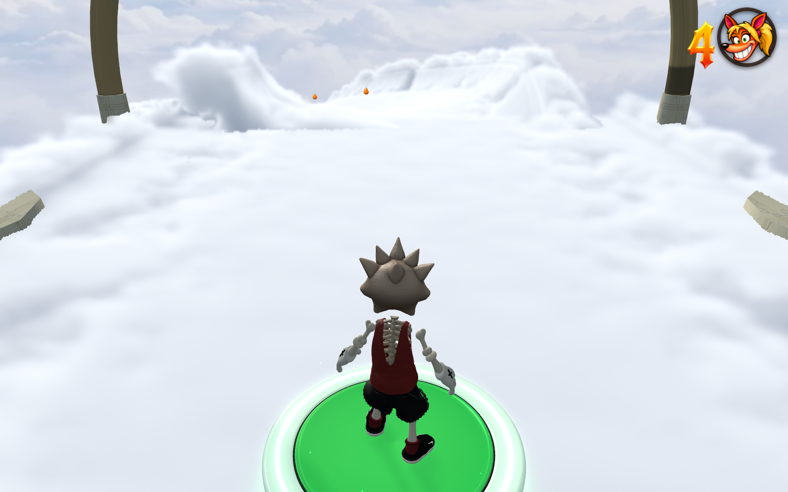

# Fixed 360p cloud paths and soft joins — 29 October 2026 NZDT

Only cloud path meshes render into a fixed-height offscreen layer. The main
course and bonus platforms share this pass. At 16:9 it is 640 × 360; at the
1600 × 1000 test viewport it is 576 × 360. Native, 720p and 480p world settings
all retain that cloud target. A world viewport below 360 pixels high is not
upsampled first. The character, collectibles, scenery, sky, sun, HUD and post
processing continue at their selected resolution. The full density field,
occupied ray spacing, geometry and smooth collision are unchanged.




## Composition and edge treatment

`CloudPathPass` renders cloud colour and depth alone, then adds a fullscreen
cloud mesh after ordinary opaque geometry and before transparent effects.
The full-resolution scene depth protects opaque silhouettes; the background
is never downsampled into the cloud image. Premultiplied colour filtering avoids
dark halos. The pass preserves camera/mesh layers, shadows, render targets,
logical and physical viewports, scissors and clear settings, including on error.

A five-sample filter at **360p** detects alpha or colour discontinuities and
feathers them over one cloud pixel. Smooth interiors retain their original
sample. The resulting narrow gradient softens cloud outlines, joins and
crossings without running another density trace or blurring the scene.

Continuous cloud depth is reconstructed from four neighboring samples during
composition, so solid/cloud intersections do not inherit a nearest-texel
staircase. Sky and large depth discontinuities retain the nearest surface to
avoid blending separate roads together. Explicit texel reads avoid unsupported
linear depth-texture filtering on some WebGL drivers. This is spatial filtering;
there is no temporal accumulation, history ghosting or camera-distance LOD.

The colour, depth and feather targets total **3.96 MiB** at 576 × 360, excluding
driver overhead. They are resized for the active viewport, shared sequentially
between split-screen cameras, and released during loading/context loss or when
no cloud meshes are present. Source cloud/density memory is unchanged.

## Measurements and checks

[Final local Chrome measurements](report.json), twelve alternating GPU queries
per variant, with the same frozen world and camera. These measure scene rendering,
including the new composition, without the game's post/UI passes:

| View | World resolution | Full-resolution clouds | 360p + soft joins |
| --- | --- | ---: | ---: |
| Road | 1152 × 720 | 28.01 ms | 14.57 ms |
| Road | 1600 × 1000 | 40.22 ms | 11.33 ms |
| Upright loop | 1152 × 720 | 19.15 ms | 7.95 ms |
| Upright loop | 1600 × 1000 | 28.34 ms | 8.10 ms |
| Wall loop | 1152 × 720 | 21.96 ms | 6.76 ms |
| Wall loop | 1600 × 1000 | 34.19 ms | 7.17 ms |

Whole-game opening-view samples with CRT enabled improved from 19.4 to 60.0 FPS
at 720p and 13.9 to 53.2 FPS at native 1600 × 1000 in the final session. These are
machine/view-specific eight-second samples, not a promised minimum frame rate.
Earlier runs varied with local load; the fixed cloud size and reduced GPU work
are the reproducible result. No benchmark ran concurrently with a build.

[GPU depth checks](depth-checks.json) preserve all 59,496 sampled opaque foreground
pixels, 9,944 transparent foreground pixels and a high-frequency checkerboard
behind a translucent cloud exactly. A sloped cloud/solid intersection differs
from native rendering at **one of 250,000 tested pixels**; mean channel error is
0.000515 out of 255. Native road and both loop views, plus normal CRT presentation,
were visually reviewed. Browser console errors: none.

Focused state tests cover fixed sizing, aspect ratio, split viewport, layer
membership, failure cleanup and target release. Shared world-frame and fixed
presentation checks pass. Build/type checking and release size pass.

```sh
node tools/test-cloud-path-pass.mjs
node tools/skystream-cloud-resolution-browser.mjs http://127.0.0.1:5187/
node tools/skystream-cloud-resolution-browser.mjs http://127.0.0.1:5187/ --occlusion-only
node tools/skystream-cloud-pass-lifecycle-browser.mjs http://127.0.0.1:5188/
npm run build
npm run check:release
```

The full browser comparison uses the dev server for Three.js imports.
`PLAYWRIGHT_MODULE` selects an installed Playwright module, and
`CLOUD_RESOLUTION_OUTPUT` selects its output directory. `--quick` also works
against a packaged/public build and checks actual scene/cloud target sizes.
The comparison toggles are exposed only through the existing debug harness.

Background research: NVIDIA's [GPU Gems 3, chapter 23](https://developer.nvidia.com/gpugems/gpugems3/part-iv-image-effects/chapter-23-high-speed-screen-particles)
describes reduced-resolution effects and the importance of depth composition.
This implementation adds no third-party code or dependency.

The [packaged full-render course](production-route.json) completes all 67 boxes,
seven checkpoints, four gaps and three loops with no deaths, bails, console
errors or failed assets. The original sky/sun and hidden smooth contacts remain
active. The verified local build is `Codex/sol fork · build 10-28 23:02 UTC`,
entry `index-BLswDUfv.js`; release size is 997,101,256 bytes of the 1 GB budget.

[Packaged lifecycle checks](lifecycle.json) pass for lite/full bonus clouds, both
split-screen views, actual WebGL context loss/restoration, and leaving for the
hub. Cloud target memory returns to zero on loss and level switch. The final
cleanup-only rebuild is `Codex/sol fork · build 10-28 23:08 UTC`, entry
`index-CviPBLml.js`, 997,101,269 bytes. The rendered course/pass is unchanged
from the complete route above. All lifecycle browser console checks are clean.
