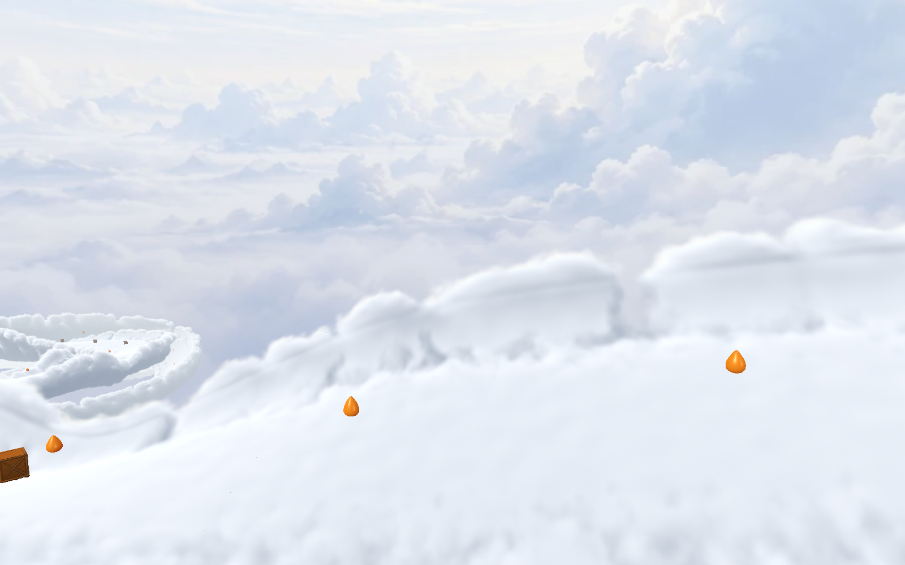
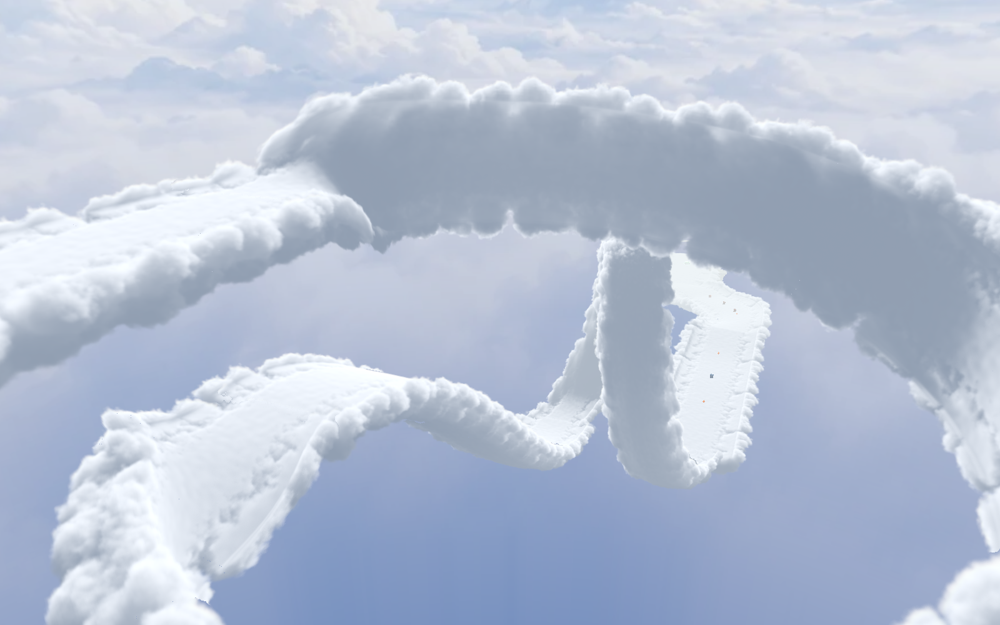
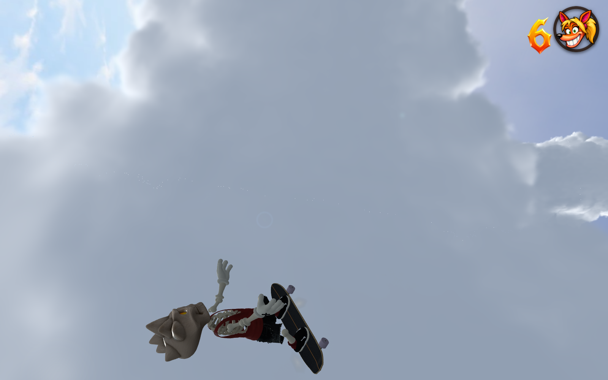

# Skystream cloud optimization and clearance — 29 October 2026 NZDT

The full volumetric road retains its 128 × 64 × 192 density field, fixed 0.2 m
occupied ray spacing, sunlight bake and complete silhouettes at every distance.
This increment speeds up the curved-coordinate calculation and avoids shading
empty proxy corners. It also places the cloud crown below the smooth contact
and deepens the lower sky while preserving the original panorama.




## What changed

- Each road chunk bakes a static inverse-coordinate map into a tightly oriented
  RGBA16F volume, with approximately one-metre cells. Hardware interpolation
  replaces repeated quaternion/frame reconstruction inside the ray loop.
  Longitudinal values are relative to the chunk centre to retain precision.
  Outside the cached domain, the original iterative frame solver remains.
- Proxy boxes follow each chunk's orientation. The GPU rejects empty box
  corners before running the expensive volume shader; the boxes never become
  visible surfaces or collision geometry.
- A conservative derivative bound for each coordinate map permits longer
  empty-space advances. It includes gutter curvature and stops skips at cache
  boundaries. Occupied samples remain on the same fixed ray grid. The unused
  experimental live-lighting branch was removed from the production shader.
- The cloud is offset 0.4 m inward along the road's local normal, including
  inverted and vertical surfaces. The crown is constrained across the complete
  rideable width plus a margin, with tall shoulder billows returning beyond it.
  Thus the existing smooth riding surface sits above the noise; contact
  geometry, movement tuning, crates, checkpoints and route coordinates stay
  aligned. This is visual separation, not a physics offset.
- The original sky image receives a stronger lower blue tint, smoothly fading
  out by 64% of its vertical span. The upper panorama and sun/bloom/flare remain.

The map adds **30.09 MiB**, bringing density, empty-space, light, frame and map
data to **61.21 MiB**, excluding proxy geometry and driver overhead. The initial
world-aligned float32 prototype used 102.7 MiB just for coordinates and was
slower; it was discarded. Map textures are owned by their proxy geometry and
disposed once with the level. They are non-enumerable in `userData` so Three.js
object cloning does not JSON-copy volume data. No new dependency was introduced.

## Controlled GPU measurements

[Same-session Chrome A/B results](gpu-comparison.json), isolated cloud pass:

| View | Resolution | Previous tracer | Optimized tracer | GPU time saved |
| --- | --- | ---: | ---: | ---: |
| Road | 1152 × 720 | 25.02 ms | 20.01 ms | 20.0% |
| Road | 1600 × 1000 | 46.75 ms | 35.09 ms | 24.9% |
| Upright loop | 1152 × 720 | 17.13 ms | 13.37 ms | 22.0% |
| Upright loop | 1600 × 1000 | 31.36 ms | 22.89 ms | 27.0% |
| Wall loop | 1152 × 720 | 21.61 ms | 16.62 ms | 23.1% |
| Wall loop | 1600 × 1000 | 41.29 ms | 29.86 ms | 27.7% |

The reference is the published `e3c203be` fragment shader and world-aligned
proxies, with the common clearance offset applied to both renderers. Both use
the same current density and lighting, so the comparison isolates tracing work.
The game animation loop is frozen while measuring; twelve serialized GPU timer
queries per variant alternate ABBA. These are local GPU medians, not game FPS.

[Whole-game pacing](game-pacing.json), with the same supported opening camera,
CRT enabled and ten-second samples per variant, improves from **20.1 to 25.0
FPS at 720p**, and **11.7 to 15.2 FPS at 1600 × 1000**. Actual drawing-buffer
dimensions were recorded. This is still an expensive experimental effect;
these machine/view-specific numbers do not promise smooth performance on every
device or view. The test alternates variant order between resolutions.

At 800 × 500, mean RGBA byte differences from the reference are 0.058–0.094
out of 255. Most are one-byte shading differences; 30–76 of 1.6 million bytes
differ by more than 32 at very small contour/ownership changes. The interpolated
coordinate cache is a numerical approximation, not a pixel-identical rewrite.
Native screenshots were reviewed against the reference. It does not change
density resolution or switch geometry with distance.

With this cached map held fixed, enabling/disabling empty skipping produces
**identical pixels in all three views**. Fixed-camera consecutive frames are
also identical. No temporal history or camera-dependent density noise is used.
The upper-sky comparison at +65° is pixel-identical to the original sky shader;
the lower and horizon comparisons confirm the stronger blue gradient.

## Validation and reproduction

The volume test exercises 1,100 contact-plane probes on a straight, guttered
road and the vertical wedding-band loop. All have zero cloud density at contact;
maximum measured normal mapping error is 0.0239 m. It also checks the derivative
bound, periodicity, crown margin, deterministic reload and exactly-once disposal.
The complete native course preserves all 67 boxes, seven checkpoints, four gaps
and three loops without deaths or bails. Deliberate fall recovery succeeds, and
all 238 coordinate/frame/light textures plus the two shared fields are released.

```sh
node tools/test-cloud-road-volume.mjs
node tools/test-skystream.mjs
node tools/skystream-cloud-coordinate-browser.mjs http://127.0.0.1:5187/
node tools/skystream-cloud-game-pacing.mjs http://127.0.0.1:5187/
npm run build
npm run check:release
```

The browser tools need the dev server for Three.js imports; `PLAYWRIGHT_MODULE`
can point to the installed Playwright module. Output paths are controlled by
`CLOUD_VOLUME_OUTPUT` and `CLOUD_PACING_OUTPUT`. Production runtime has no test
hooks or comparison materials added by these tools.

The [packaged full-render route](production-route.json) also completes all 67
main-course boxes, seven checkpoints, four gaps and three loops without deaths,
bails, console errors or failed requests. Native loop screenshots confirm the
skater remains visible above the cloud. The normal CRT presentation was reviewed.
Build/type checking and release size pass (997,093,655 bytes of the 1 GB budget).


