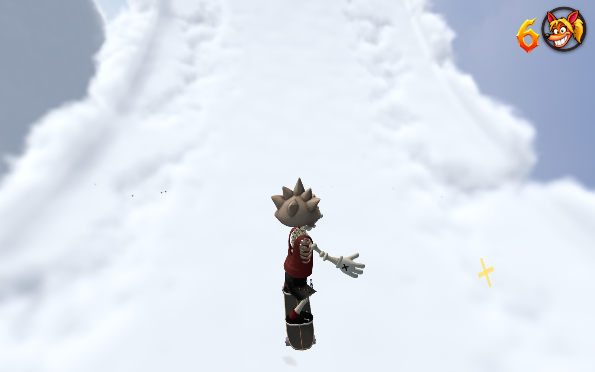

# Skystream wall contact and cloud ledges — 29 October 2026 NZDT

Skystream and Cumulus Cache disable automatic ledge catches through the optional
`ledgeGrabs: false` level setting. Both wall and mesh detection obey it; other
levels default to their existing behavior. Validation and editor capture preserve
the setting. Grinding boundaries and movement tuning are unchanged.

The sideways loop's contact point already followed its smooth collision surface,
but the character root incorrectly used the upright loop's X-axis somersault.
The wedding band now rotates the rig's up axis toward the inward surface normal,
then uses its existing tangent heading. The entry and exit banks remain smooth.
Upright loops keep their continuous full-turn frame through the inverted apex.
Wall-loop carve lean uses track-local steering, preventing a held forward stick
from creating a false sideways lean as the road turns.

## Evidence

The [baseline pose test](pose-before.json) found zero contact-position error but
a minimum board-up/contact-normal dot product of **0.0260** on the wedding band,
equivalent to an approximately **88.5°** pose error. The [corrected test](pose-after.json)
covers all three authored loops, a rotated wedding band and deliberate steering.
Straight riding keeps wheel contact within **0.995–1.132 mm** of the smooth wall;
the steering case stays within **1.44 cm**. The minimum wall alignment dot across
entry, turn and exit is **0.9984**, including the intended carve lean. The test
drives real Player/Level simulation after placing the fixture at its approach
with known initial momentum; it does not overwrite contact or pose during motion.

The [native routes](routes.json) finish all 67 main boxes, seven checkpoints,
four gaps and three loops without deaths or bails. Deliberate fall recovery
returns to the earned checkpoint. The bonus finishes all 18 boxes and five gaps
without deaths. The [lite browser check](browser-lite.json) starts from rest on
the real wall-loop approach and completes all four quarters using held forward
and skate input. Both live level objects have ledge catches disabled; console
errors are empty.

The supplied [replay check](replay-check.json) did not reach the finale in native
or packaged-browser playback here. The exact user recording is therefore not
claimed as a passing regression; the independently reproduced pose defect and
real course traversal are the basis for this fix.

## Focused checks

```sh
node tools/test-level-ledge-policy.mjs
node tools/test-skystream-loop-pose.mjs
node tools/test-skystream.mjs
node tools/test-skystream-bonus.mjs
node tools/skystream-wall-loop-browser.mjs http://127.0.0.1:5188/ --lite
npm run check:levels
npm run build
npm run check:release
```

All checks above pass. The ledge policy fixture exercises both real grab paths,
default/explicit opt-in/opt-out, schema rejection and round-trip capture, and
asserts that ordinary grinding boundaries remain present. `PLAYWRIGHT_MODULE`
selects an installed Playwright module; `SKYSTREAM_WALL_OUTPUT` selects browser
evidence output. Omit `--lite` for full native rendering followed by normal CRT
presentation. The packaged build is `Codex/sol fork · build 10-29 01:04 UTC`;
release output is 997,101,573 bytes of the 1 GB hosting budget.

The [packaged full-render route](browser-full-route.json) also completes all 67
main boxes and all three loops with no deaths, bails, console errors or failed
requests. All four wall-loop quarters keep the board aligned (minimum dot
0.9999986; steady wall 1.0). Native 1600 × 1000 screenshots were visually
reviewed, followed by the normal 720p/CRT presentation.


