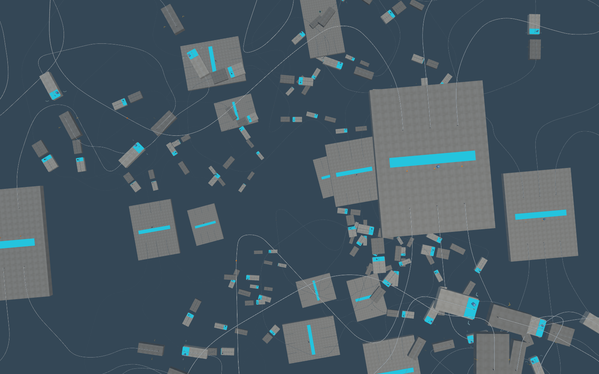

# P1 platformer with rotating infinite space — local preview

2026-11-03. Selected foundation: gallery **P1**, commit
`bf079d7c9d2231663a8066f2395a51150080a2d1`. Prompt to validated local preview:
approximately **23 minutes**.

Play: <http://127.0.0.1:5248/?playtest&level=spaghetti-rails-platforming>

Preserve P1's folded maze exactly: 79 platforms, 54 authored rails, 18 branch
routes, 41 checkpoint crates, 30 fruit and the corrected crystal/finish. The
original geometry fingerprint is checked against the historical P1 hash.
Remove its fatal abyss and replace the finite sky with distance fog. The race
keeps the separate version 1 downhill layout and its existing improvements.

## Repeating space

The physical cell spans Y = 0–192 m. Every lower instance turns **5°** about
XZ = (-50, -130). Native gravity produces a 3.93-second fall through the first
cell from rest, then 3.69 seconds per cell at 52 m/s terminal speed. This is the
repeat interval; actual landing time depends on trajectory and which original
P1 platform or rail the player reaches. No floor has been added across the maze.

One screw transform owns both the rendered neighbours and the seam rebase.
When crossing down, translate up 192 m and rotate -5°; crossing up uses the
inverse. Position history, momentum axes, character interpolation, collision
history and camera anchors move together. Speed, gravity, tricks, checkpoint
and collected rewards remain gameplay state, not respawn state.

Retain P1's height-aware branch navigation. During a fall the course camera
holds its orientation and input frame; real support resumes the authored
route. Full vertical follow and the existing sightline correction keep the
character visible. Ordinary non-twisting levels keep their existing behavior.

Rendering retains exact native geometry, shared materials, existing spatial
batches and frustum culling. A fixed nine-cell view covers the fog distance;
falling further creates no new simulated worlds. Dynamic visibility mirrors
the original pickups and broken crates. No geometry simplification or tuning
changes were introduced.

## Validation

- Native: original P1 geometry equality, 18 height-aware branches, strict
  configuration validation, upward/multiple-cell inverse transforms, live and
  static render copies, fractional character interpolation, active launch
  camera rebasing, supported spawn and ordinary checkpoint contact.
- Five consecutive still falls; three moving wraps with held input and
  nonzero momentum; upward passage with positive velocity; native collision
  on the rotated starting deck; checkpoint retained through a real fall;
  crystal collection and normal finish gate. No deaths in these fixtures.
- Chrome lite and full at 1600×1000/MAX, plus normal presentation. Three moving
  falls retained the camera orientation and input direction, with the visible
  body inside frame for all 683 sampled full-render frames. Up/down inspection
  shows the progressively rotated stack extending into fog. Console clean.
- Separate full-render race smoke confirms its unchanged 288 m, non-twisting
  wrap and working race start. Exact-geometry batching, legacy launch camera,
  render interpolation and camera-rig regression checks pass.
- `npm run check:levels`, `npm run build`, `git diff --check`: pass. Build
  offline version `497b71ca30729840d34a`, 1,751 files / 765.2 MiB. No full suite.

These are controlled local traversal/contact fixtures, not a complete all-box
playthrough. Evidence: [native](p1-twist-evidence/native.json),
[full browser](p1-twist-evidence/full-browser.json),
[checks](p1-twist-evidence/checks.json).

## Ownership and local delivery

Level sources: `spaghetti-platformer-p1.ts` and
`spaghetti-rails-platforming.ts`. Shared runtime changes:
`verticalLoop.ts`, `player.ts`, `renderInterpolation.ts`, `main.ts`,
`level.ts`, `cameraRig.ts`, `launchCamera.ts`. Rotation and airborne frame
retention are opt-in through `verticalLoop.twist`; the race does not opt in.
No `public/levels.json`, movement tuning or race-layout change.

The local server uses `.release-queue/serve-local-preview.mjs` and an isolated
Vite cache on port 5248, avoiding stale dependency URLs from native test
servers. The immutable history gallery on 5260 and P1 snapshot on 5267 remain
available. Commit locally only; do not integrate or publish without a later
user request.
