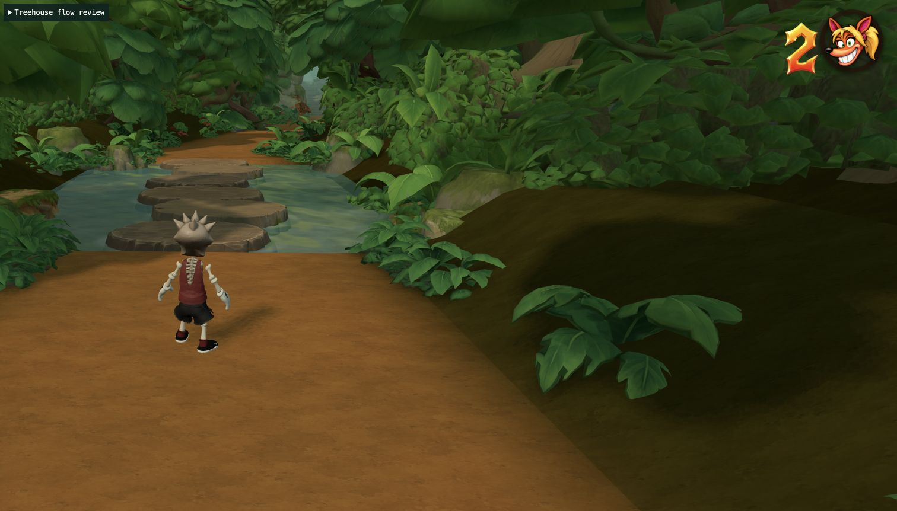
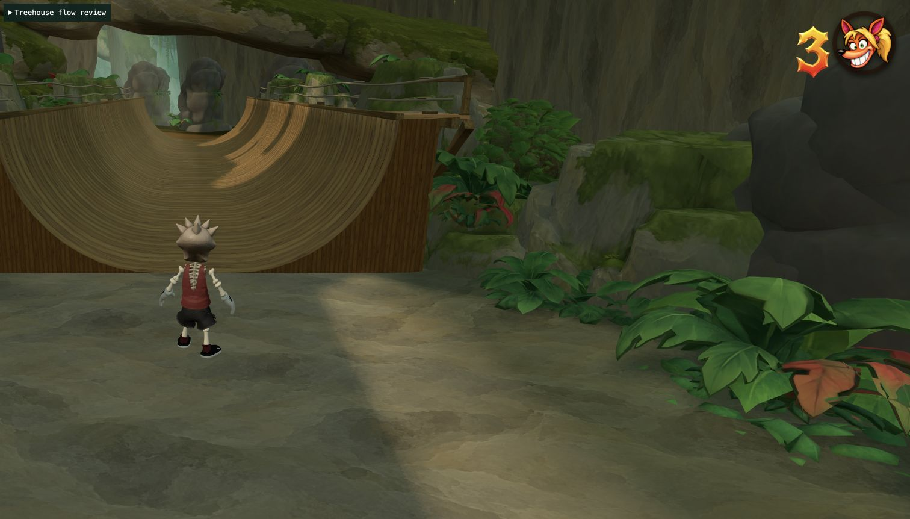
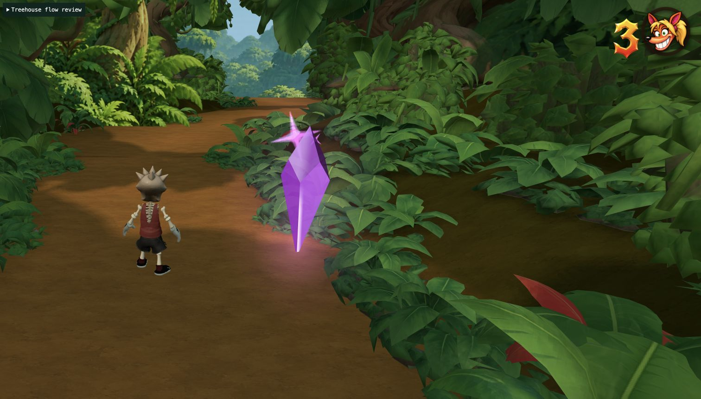

# Treehouse Trails river and final approach

The shallow river is 24 m across with six original-size stepping stones and
their measured collision surfaces. Both ends of the cavern halfpipe have fitted
timber panels beneath the riding surface. The path gains 30 m after the cave
bend, leaving 37.5 m straight before the existing 25 m rope. Four small ferns
and four low leaf clusters sit before the end matte; the exposed soil edge
beyond the finish is closed.

All changes use level data and existing assets. Native movement, ordinary deck
edge grinding, the rope gap, and complete asset meshes are retained.

`node tools/test-treehouse-flow.mjs` checks all six measured contacts, native
walking/skating river crossings, outward cap faces, both halfpipe entrances,
continuous runway support, straight lane directions, and a sustained grind on
the actual rope followed by a supported landing. See [runtime.json](runtime.json).

The local review page is
`/treehouse-flow-review.html?playtest&level=treehouse-trail` (add `&lite` for
the light render). Its controls place a starting fixture, then submit ordinary
inputs to the production Player. The full-render halfpipe-to-finish run took
21.8 seconds, crossed the rope, banked a checkpoint and reached the gate without
a death. The last 30 m of approach stayed within 0.038 degrees of forward;
maximum frame-to-frame camera rotation there was 0.004 degrees.

The raw [browser record](browser.json) also retains an exploratory river-to-cave
pilot that hit the existing enemy before the cave. The river and final cave
section were consequently verified as separate focused crossings.

Chrome review covered lite, normal full rendering and MAX/native
3024 × 1724, supported checkpoint recovery, and a clean console. Required level
checks, production build and release-size check passed. Release size:
805,692,064 bytes. No full regression suite was run.

