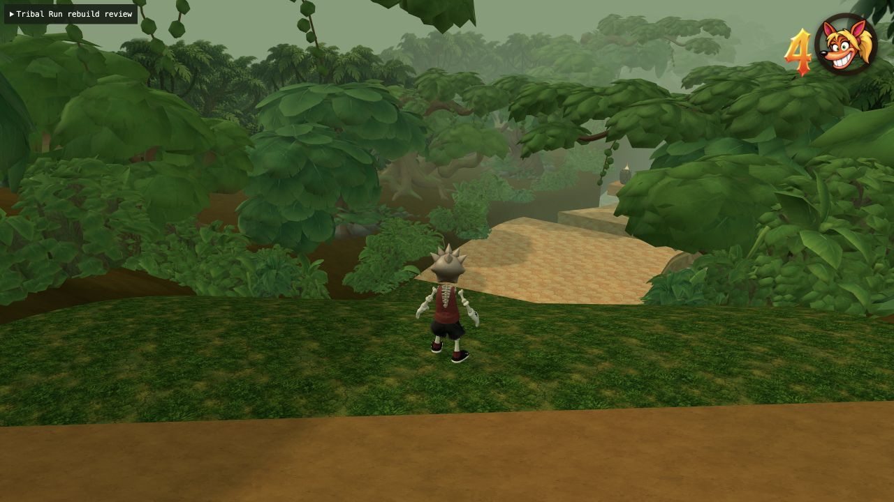
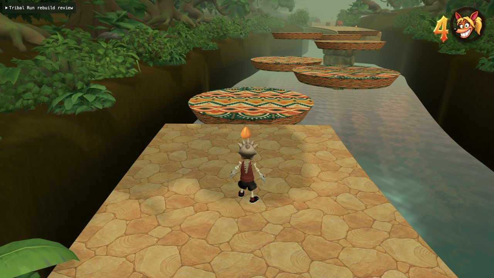
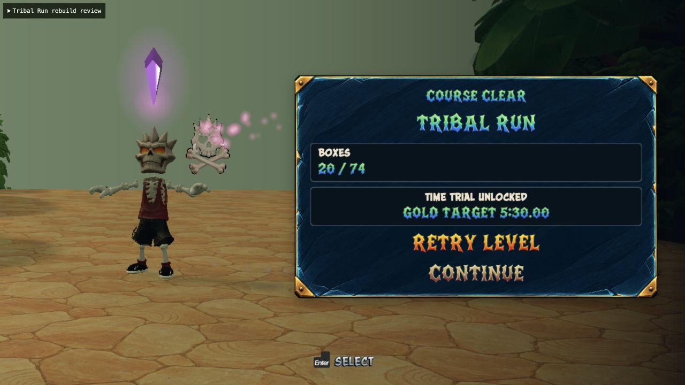

# Tribal Run: mixed jungle platforming

The old course repeated long, flat causeways and a ferry crossing almost thirty
times. The rebuilt 2.32 km route has eight distinct passages, with climbing
ground, wet moss descents, sideways stepping-drum transfers, alternating lifts,
orbiting platforms and seven authored grinds. Its ground spans -4 to +22 m.

| Passage | Main traversal |
| --- | --- |
| Rootstep Rise | Rooted climbs, a ferry, a ridge grind |
| Rainwash Chutes | Two wet descents, dry braking areas, a gap, lifts and an orbiting drum |
| Crosscurrent Drums | Seven offset rising drums, a diagonal river rail, a bank jump |
| Great Drum Court | High-bank ferry, descent into a combat/bonus court, climbing rail |
| Canopy Weave | Alternating lifts, five zigzag drums, a 22 m crest and descending rail |
| Sunken Stair | Ferry, moss chute, stone gap and low-basin lift pair |
| Echo Switchbacks | Downhill rail, climbs, orbiting drum, slide, jump and high drum weave |
| Last Chorus | Uphill grind, long moss descent, three rising decks, crystal grind and finish |

There are 29 moving platforms, six slippery sections, seven rails, nine restart
checkpoints, 35 patrol enemies and eight fire heads. The two-piece lift pairs
and three final decks have clear physical gaps: no overlapping high deck can
steal the lower deck's ground contact. Downhill rail receivers widen to 26 m;
slippery chutes widen to 25 m with dry runouts. Patrols and fire heads are kept
off fast landing/braking areas. The crystal follows the final rail's exact
height and lateral curve.

Wet moss reuses Carlisle Coast's texture and native traction/gravity fields.
The player movement tuning is unchanged. New drums are closed, hand-built
96-triangle meshes; the rendered crowns are the actual moving colliders.
Existing forest assets retain their complete geometry at every distance.
Continuous closed banks meet the paths and widen around the river crossings.

## Camera evidence

The old camera was stable on flat ground, but followed too much of each jump.
Tribal Run now uses a level-scoped 0.12 air-follow weight, a wider composition
and ordered river-axis nodes. It does not follow the lateral zigzag of each
drum. No shared camera or movement behavior was retuned.

Real-browser traces of the first ferry's exit jump:

| Trace | Player rise | Camera rise |
| --- | ---: | ---: |
| Before | 4.596 m | 2.977 m |
| After | 4.578 m | 0.496 m |

These are measured relative to each jump's takeoff height; the rebuilt ferry
itself is on higher ground. Deduplicated fixed-frame samples are preserved in
`camera-before.json` and `camera-after.json`. The visible development controls
in `tribal-moving-review.html` record the actual rendered camera.

## Character work remains blocked

The reported crab issue was real: `appearance: 'tribal'` loads the ordinary
crab GLB and attaches a mask costume. That model has **not** been replaced yet.
The requested Pacific guardian has a completed imagegen reference with an
explicit Crash 4 pass and the current Bone Man as a proportion reference.

Meshy's authenticated API balance was one credit, and the web workspace was
signed out. No billable generation or rigging task was submitted. The user
was asked to sign in to the opened workspace to use plan credits. The prepared
reference, exact prompt and official-CLI job journal live in
[`tools/tribal-guardian`](../../tools/tribal-guardian/README.md).
The intended generation is Smart Topology at 15,000 triangles, then a measured
humanoid rig, shared segment elasticity and multi-angle motion review. This
course update does not claim that character work is complete.

## Validation

The focused native test uses the production Player and Level and the same
input-only pilot as the real-browser review. It does not change movement
tuning, position, velocity, checkpoints or collectibles during a run. It
exercises all moving supports and rails, then requires zero deaths, all nine
checkpoints, the crystal and a finished state. Collision probes test actual
runtime meshes at road centres, edges and joins, plus crate support, open
gaps and camera heading continuity.

The complete native run passes in 24,635 fixed frames (410.583 seconds): all
29 moving supports, seven rails, nine checkpoints, the crystal and finish,
with zero deaths. It includes 604 frames of actual slippery contact. The
collision audit passes 1,740 support/seam probes, 580 heading probes, 45 crate
seats and all 23 open gaps. Maximum sampled support error is 0.0352 m; minimum
camera/route heading dot product is 0.9862. The required `check:levels` command
also passes. Exact native evidence is in `native-0-22.json`.

The continuous full-render browser run reaches the real **COURSE CLEAR** result
with the crystal, all 29 moving platforms, nine checkpoints and zero deaths in
416.467 seconds. Its console has no warnings or errors. The production result
flow consumes the transient finished state before the development generator
returns, so the rendered result UI is the browser's finish evidence. A separate
river-drop check returns the player to the final activated checkpoint at
`[371.27, 12, -1180.01]`. MAX/native and normal 720-line views were inspected.
See `browser-full.json` and the course-clear screenshot below.

An ES2020-compatible last-array-element expression replaces `Array.at` before
the production build. The complete authored level-data SHA-256 is identical
before and after that compatibility-only edit:
`d2f42eee83e87e260fd566f80f1fe857c173c45fb83b350e51cdd8c7883e376c`.

Production type-check/build and release-size validation pass: 1,854 files,
810,281,371 bytes, within the existing 1 GB hosting budget. No full suite ran.

```sh
node tools/test-tribal-rebuild.mjs --audit
npm run check:levels
npm run build
npm run check:release
```

Native/MAX views:






