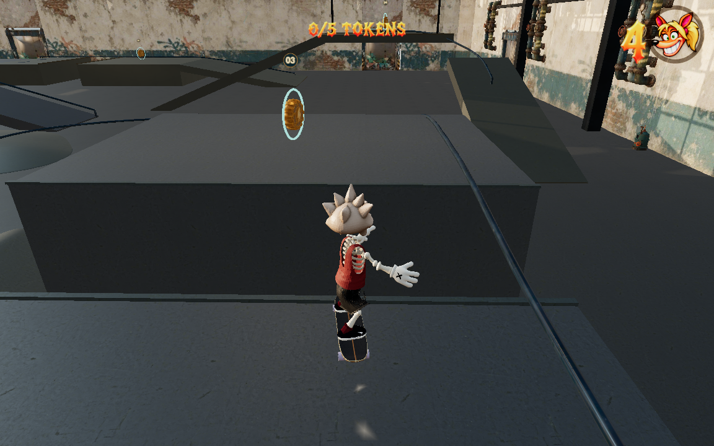
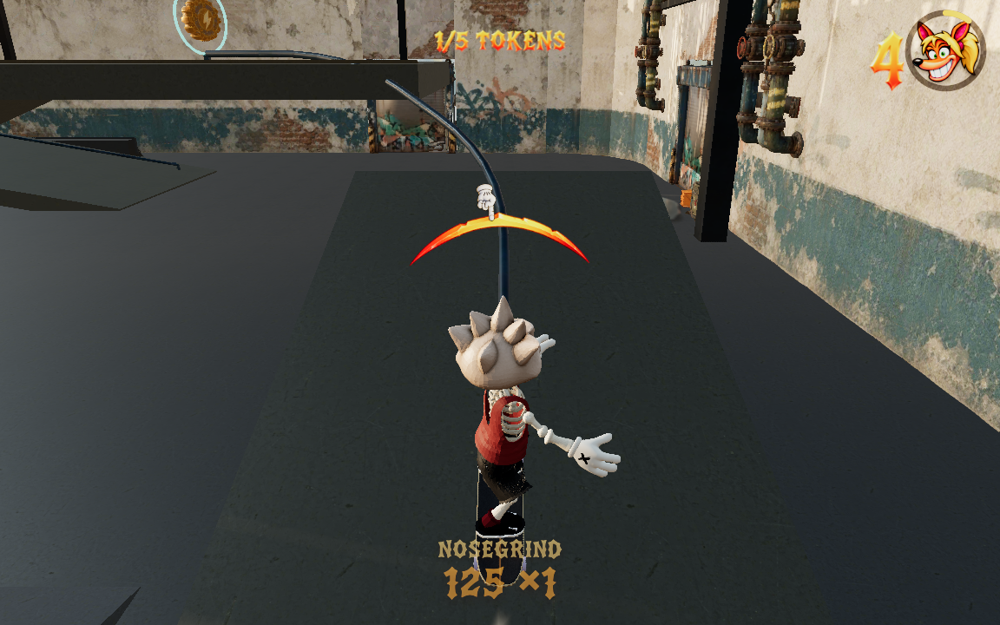
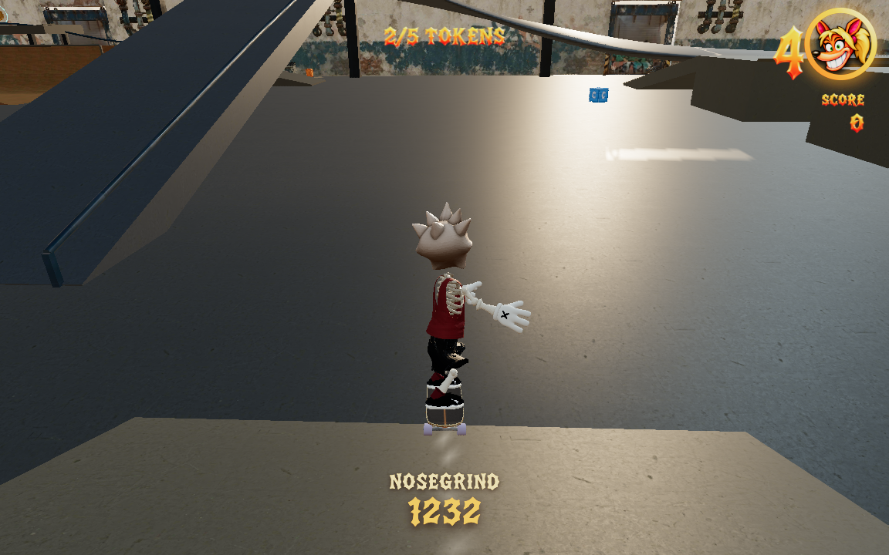

# East session validation

Validated on 17 October 2026 against the rebuilt warehouse working tree at `http://127.0.0.1:5332/`, after the Crane rail was shortened to start above its approach bank. This is a full-render development-browser test, not a public-deployment test.

The [input plan](plans/east-session.json) begins at the real spawn and uses the normal gamepad, input, simulation and renderer pipeline. It obtains Workshop token 3 and Crane token 4, then returns to the main floor. It never teleports, writes a player pose, replaces the camera, or activates a checkpoint through automation.

## Result

Full report: `/private/tmp/warehouse-east-session-final/report.json`. Matching per-frame data, actual native replay, canvas captures and a viewport video are alongside that report. The earlier current-source lite run also passed at `/private/tmp/warehouse-east-bank-fed/report.json`.

| Measurement | Full-render result |
|---|---:|
| Simulation / wall time | 21.40 s / 21.398 s |
| Distance | 226.56 m |
| Render observations | 1,260 |
| Collected tokens | 3 and 4 |
| Bails / deaths / render snaps | 0 / 0 / 0 |
| Browser errors | 0 |
| Observed grind frames | 236 |
| Maximum combo multiplier | 1 |
| Median / p95 observation interval | 16.7 / 20.5 ms |
| Maximum fixed steps in one observed frame | 6 |

The run retained `skatepark: true`, `alwaysSkate: false`, `cameraRig: null`, and the shared competition FOV of 49. No look-stick commands were supplied. Recording and visibility probes were enabled, and another independent browser trial overlapped this run, so the timing figures are descriptive evidence rather than an isolated performance benchmark.

## Exact route and walking reset

The player walks briefly from spawn, mounts normally, turns east, charges up the Workshop approach and releases a jump at its takeoff. The first pass obtains the Workshop token while skating. Both the takeoff and receiving deck are visible at the actual commitment frame.

This is **not an uninterrupted skating combo between the two goals**. After the Workshop descent the plan deliberately holds jump and brake until dismounted near `(29, 0, -80)`. It walks back along the workshop side toward `(35, 4.8, -62)`, performs a short lateral hop over the ordinary side rail, walks to the ground approach near `(44, 0, -59)`, and remounts. The rail is a real obstacle; earlier attempts that tried to walk straight through it stopped and were rejected.

The Crane approach rides the bank before catching the **authored Ascending crane-service rail**, confirmed by `railSource` and `railKind` telemetry. The catch occurs near `(43.95, 3.67, -78.22)` at 14.25 m/s. The token arrives 3.53 seconds later, with the grind slowed to 3.5 m/s. Balance input continues after collection until the actual rail exit. The return ramp then feeds the floor at `(7.79, 0, -94.14)`, heading approximately `(-0.998, 0, 0.059)`, still skating at 26.12 m/s. This is the splice point for a westbound continuation.

No stationary interval exceeded the runner's 0.5-second reporting threshold. That statistic does not erase the intentional braking, dismount and walking setup described above.

## Actual competition-camera captures

These are byte-for-byte copies of the original full-render game canvas captures. They were not edited, reframed or rendered from an inspection camera.

## Limits and rejected attempts

- The optional direct Workshop-roof-to-Crane ollie has **not** passed. The best early setup launched from approximately `(31.94, 4.8, -61.99)` at 15.63 m/s, but reached the floor near `(40.51, 0, -75.34)` before the Crane bank/rail. The later target-following continuation wandered and bailed. Evidence is retained at `/private/tmp/warehouse-east-expert-carve/report.json`; it must not be represented as a successful connection.
- Earlier late-launch and misaligned attempts are retained separately. They do not qualify as successful skating pickups, even where a subsequent walking turnaround happened to collect a token.
- Automated target steering uses world-position feedback. This proves execution under normal controls, not first-time discoverability or the ability of a novice to infer the complete route.
- The final saved plan updates the Crane visibility target from the obsolete low-rail point to `[44, 5.3, -82]`. Controls and termination conditions are identical to the successful full run. Its original report's low-rail point visibility is therefore not evidence about the new rail's entire silhouette; the inspected commitment image supplies the visual evidence.
- This session demonstrates two distinct challenge routes and optional walking. Central cross-district combos, all-five completion, collision recovery elsewhere, publication and deployment require their own evidence.
