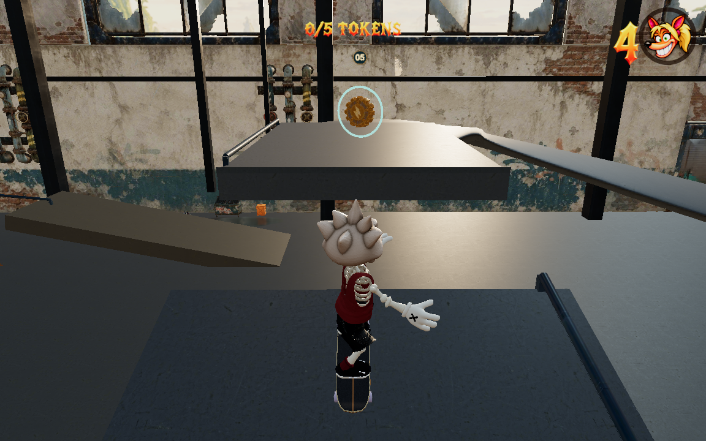
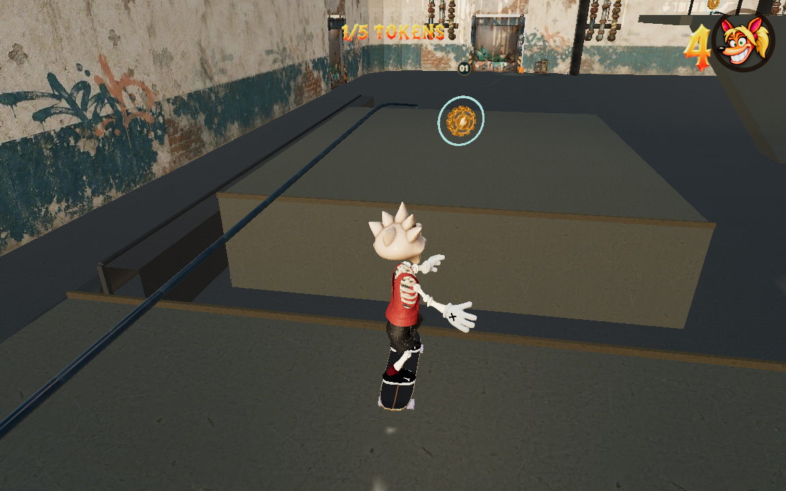
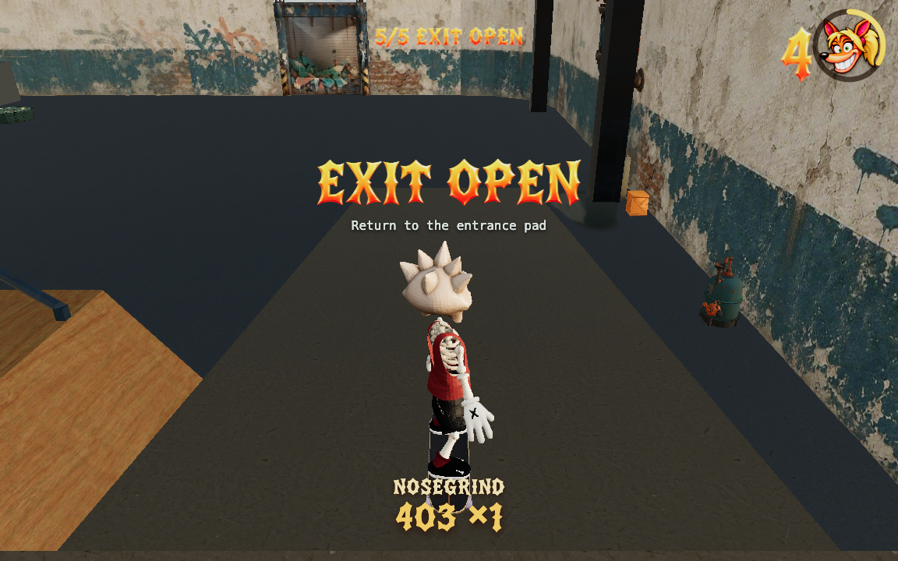

# Western session — final handoff

The final full-render reverse-order run starts at the real spawn and collects Maintenance → Loading Dock → Gallery in its first **38.02 seconds / 449.2 metres**. This prefix has no stops, bails, deaths or render snaps. It then uses the explicitly named walking connector to the east district. The complete run finishes all five goals and the actual gate in 83.93 seconds. See [the input plan](plans/collectathon-west-first.json) and `/private/tmp/collectathon-west-first-attempt-04/report.json`.

Maintenance's charged gap lands on the high shelf, the carved descent feeds directly into the dock takeoff, and the dock's downhill exits onto the floor. The floor connector passes under the elevated return before turning onto the Gallery pump bank. That bank feeds the short rising rail; balance assistance remains active until the actual rail exit. The shelf's south exit now lands on its intended bank and descends to the floor.

The final grounded Gallery contact is approximately `[-47, 3.146, -33.475]`, with `groundComponent` explicitly equal to `Gallery return / forgiving drop`. Earlier footage revealed that the old bank nose was too far away and the rider passed underneath it despite a green no-bail result. Moving the nose north three metres fixes the physical handoff; both complete pickup orders verify real bank contact.

Other real-play corrections include moving the maintenance shelf rail away from the return mouth, moving hanging members out of the approach sightline, and moving the Loading checkpoint crate four metres away from the natural floor aisle. An earlier Gallery connector crossed a rail sideways; the accepted connector uses the much shorter open floor beneath the elevated return.

These are unedited captures from the actual competition camera on the final layout:

The controller knows destination coordinates and balances grinds. This is execution and camera evidence, not a claim of novice discoverability. The source keeps shared competition camera settings and optional walking unchanged.
